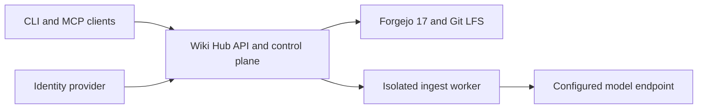

# wiki-hub

A small knowledge service built on Forgejo 17, Git LFS and Markdown. One application
provides an authenticated API, MCP tools, ingestion jobs and the `wiki` CLI.
Original documents and accepted pages live in private Git repositories. Search is
rebuildable. Ordinary ingests save automatically with source references and history.

The configured owner creates new wikis and can share each one explicitly with other
signed-in people. Authentication uses an external OAuth provider; the deployment
supplies the owner's immutable subject identifier. New identities see no wikis.
Migration of existing knowledge is a separate step.

## Start here

- [Self-hosting](docs/self-hosting.md): a standalone Compose example with Forgejo
  17, Pocket ID and a restricted model worker.
- [Clients](docs/clients.md): CLI, local MCP, hosted Claude/ChatGPT and agents.
- [Network drive](docs/drive.md): one drive per person with exactly the wikis they
  may read and editable pages where they may write, over SMB on a LAN or private route.
  Windows connects with one PowerShell line and nothing to install.
- [Model worker](docs/ingest-runner.md): bring a compatible model endpoint or use
  an existing trusted sandbox.
- [Operations](docs/operations.md): consistent backup, populated restore and upgrades.
- [Roadmap and remaining work](docs/roadmap.md): implemented capabilities, rollout
  acceptance and the boundary between knowledge and application state.
- [Security](SECURITY.md) and [contributing](CONTRIBUTING.md).

The bundled worker returns source-backed file edits without executing model
tools or commands. It makes one configured model request per ingest; provider
failures remain visible rather than triggering an automatic paid retry.



## Development

Python 3.12+, Git and Git LFS are required. Run `make check`. Integration tests use
temporary repositories and a fake sandbox; they never contact a production wiki.

## Usage

Install with `uv tool install .`, then:

```sh
wiki --server https://knowledge.example.org login
wiki create starter --title "Starter wiki"
wiki contribute starter ./source.pdf
wiki status JOB_ID
wiki search starter "a question"
wiki read starter wiki/index.md
wiki docs get starter raw/SOURCE.pdf --output ./source.pdf
wiki clone starter ./starter
wiki sync ./starter
wiki log starter
wiki rollback starter COMMIT
wiki whoami
wiki share starter RECIPIENT_SUBJECT --role read
wiki access starter
wiki unshare starter RECIPIENT_SUBJECT
wiki share starter TRUSTED_ADMIN_SUBJECT --role admin
wiki settings starter --local-copies deny
wiki user set RECIPIENT_SUBJECT --local-copies deny
wiki user status RECIPIENT_SUBJECT
wiki user suspend RECIPIENT_SUBJECT
wiki user resume RECIPIENT_SUBJECT
wiki drive connect
wiki drive status
wiki drive disconnect
```

For a local MCP client, configure `wiki mcp` after signing in. The remote streamable
HTTP endpoint is `/mcp`; OAuth resource metadata is published at
`/.well-known/oauth-protected-resource/mcp`. Tools return source paths and Git revisions.

Windows stores credentials in its credential manager. On headless Unix, the CLI can
use an owner-only configuration directory when no OS keyring is available. Git
credentials are narrowly scoped and never embedded in remote URLs or printed.
Large Windows sign-in records use multiple credential-manager entries to respect
its per-entry size limit. Refresh saves a new complete record before replacing the
previous one; credentials are never written to a plaintext Windows settings file.
CI checks login and refresh with synthetic tokens on native Windows.

Local copies start with Markdown and Git LFS pointers. To retrieve an original PDF
or other source, use its cited `raw/` path with `wiki docs get` and choose a new
output file. Downloads use the current sign-in, refresh it when needed, and remove
incomplete files after a failed transfer. Existing output files are never replaced.
The server verifies original hashes in a private temporary file before serving
them, keeping application memory bounded for existing large LFS documents.

Recipients obtain their exact sign-in subject with `wiki whoami`. A `read` grant
allows retrieval and `wiki clone --read-only`. `contribute` also allows sources to
be ingested automatically. `write` also allows writable Git copies and rollback.
The wiki owner and its explicitly delegated admins manage shares and the wiki's
copy policy. A wiki admin gets no access to other wikis or global user settings.
Only the configured owner changes a person's copy setting. Every API/MCP operation checks the current
grant; the local copy's Git account has the same repository permission in Forgejo.
Removing a share stops subsequent API, Git and LFS access. Existing downloaded
content and transfers already in progress cannot be recalled.

If Forgejo is unavailable during a permission change, API access for that share is
denied and `wiki access` shows `pending: 1`. Git may retain its previous permission
until Forgejo recovers. Repeat the same share/unshare command to finish; do not
treat a failed permission command as successful revocation. This state survives
restarts. Group synchronization, invitations and expiring shares are deferred.

Git copies require both the person's and the wiki's local-copy settings to allow
them. Both default to allow for existing installations. `wiki settings WIKI`
and `wiki user set SUBJECT` without a flag show the current setting and whether
its backend update is pending. Disabling copies revokes previously issued managed
Git tokens for that repository, including its owner's tokens, and removes direct
repository membership where applicable. API/MCP reading and source downloads
remain available to authorized readers. A failed change stays pending and denies
new copy credentials; repeat it to finish after Forgejo recovers. Re-enabling
copies permits a fresh clone; old revoked tokens do not become valid again.
These settings control supported Git copies; readers can save content they receive
and completed downloads or previously issued download links cannot be recalled.

The configured owner can suspend a human subject with `wiki user suspend SUBJECT`.
This blocks Wiki API/MCP operations, including existing sessions and agents owned
by that person, and revokes their managed Git credentials across all wikis.
Ownership, grants, sources and history are retained. A publication already accepted
before suspension may finish; suspension waits for it before reporting success.
An unfinished model job cannot publish after suspension succeeds.

`wiki user status SUBJECT` reports `suspended` and `pending`. A failed backend
change remains pending and blocks Wiki operations across restarts; Git may retain
its previous access until revocation completes. Repeat the same command to finish.
Only `wiki user resume SUBJECT` restores access under the current grants and copy
settings. It does not revive revoked Git tokens or explicitly revoked agent keys.
Suspend the configured owner only after changing the deployment's owner setting;
the command refuses to suspend itself. Enrollment and provider disablement remain
the identity provider's responsibility. Coordinate both actions when offboarding
a person; changing the provider alone does not immediately block Wiki access.

`wiki sync` on a new read-only clone fetches updates without committing or pushing
local edits. Local edits stay on the computer. Git stops when an update would
overwrite them or when the local branch has diverged. Writable clones keep the
normal commit/merge/push workflow and stop for unresolved conflicts.

Wiki admins can run `wiki archive handbook` to keep a wiki readable while stopping
content writes and Git pushes. Sources, history, grants and copy policies remain.
Archived wikis disappear from the default catalog; use `wiki list --include-archived`
or read a known wiki directly. `wiki reopen handbook` restores writing under its
existing permissions. Agents cannot archive or reopen wikis.
Admins can prepare read/contribute agent grants while archived, capped by the
active owner's role. Archival continues to block ingestion until reopening.

Archiving interrupts queued and running ingests; reopening never retries them.
A publication already in progress finishes before archive reports success.
Incomplete backend updates remain pending and read-only across restarts; repeat
the operation to finish. Check `GET /api/wikis/handbook/archive` for status. Git
may retain its previous access until the backend update completes.

Both transitions revoke managed Git credentials. Sync renews a writable copy's
credential when its effective write permission changes. For a revoked credential
whose permission has stayed the same, run `wiki sync DIRECTORY --refresh-credential`.
Explicit read-only copies remain read-only. Local edits are retained.

Use `wiki sync --all --root ~/Wikis --json` to synchronize the managed copies
directly inside a folder. Each copy uses its own saved server/credential, current
copy permission and OS lock. Other repositories are skipped. A failed copy does
not prevent the others from being checked, and the command returns failure if
any copy fails. Add `--discover` to create missing eligible copies from your
signed-in server first. Readers and contributors get read-only copies. Discovery
preserves existing folders, skips wikis whose copy policy disallows it and never
grants access. Without this flag, batch sync only updates existing copies.
See [device sync](docs/clients.md#device-sync) for schedulers, exclusions and WSL.

The configured owner can register a separate agent credential:

```sh
wiki agent add source-filer --directory ./source-filer-config
wiki share starter agent:RETURNED_ID --role contribute
wiki agent list
wiki agent revoke agent:RETURNED_ID
```

Registration saves the credential into the agent's new private CLI configuration
and prints only metadata. Point that agent's CLI or `wiki mcp` process at the
returned directory with `WIKI_CONFIG_DIR`; it contains no human OAuth credential.
Use a separate process/account or a limited filesystem mount when handing it to
another runtime. The server stores only a hash of the revocable key. Keys remain
valid until revoked; register a replacement to rotate one.

Agents start with no wikis and need explicit `read` or `contribute` grants. They
cannot receive write/admin access, create wikis, manage shares, obtain Git
credentials or roll back content. Their effective access also requires their
owner's current wiki grant. Revocation is checked by the API and on every MCP
operation, including sessions already connected. An unfinished ingest cannot
publish after its agent is revoked. A publication already underway is allowed
to finish before revocation returns.

An existing Pocket ID workload can instead use
`wiki agent add source-filer --workload-client source-filer`. It starts with no
wikis and uses the same explicit grants and owner ceiling, without another local
secret. See [workload enrollment](docs/clients.md#pocket-id-workloads) for native
OAuth setup, identity binding, diagnostics and revocation.

## Operations

The server requires `WIKI_PUBLIC_URL`, `OIDC_ISSUER`, `WIKI_OIDC_CLIENT_ID`,
`WIKI_OWNER_SUBJECT`, `FORGEJO_URL`, `FORGEJO_PUBLIC_URL`, `FORGEJO_USERNAME`,
`FORGEJO_PASSWORD` and `WIKI_INGEST_URL`. `OIDC_JWKS_URL` may point to the provider's
internal key endpoint; token issuer and audience checks still use the public URLs.
`WIKI_STATE_DIR` and `WIKI_WORKSPACE_DIR` contain persistent state and working copies.
Run one application worker. Ingests are serialized per wiki.

`/health` reports process availability; it does not prove provider access or model
quality. After deployment, check login, Git/LFS, a real ingest, source-backed retrieval,
rollback and a populated restore separately. Interrupted jobs remain visible after a
restart. An indexing failure cannot undo an accepted Git commit.

Back up Forgejo configuration, databases, repositories and LFS together with the
identity provider and application state. Stop writes while taking a consistent copy,
then restart before uploading the copy off-site. Rehearse restores on a separate
instance. API and MCP reads recheck access after waiting for repository work and
before returning content, including original-source downloads. Content already
sent or downloaded cannot be revoked remotely.
